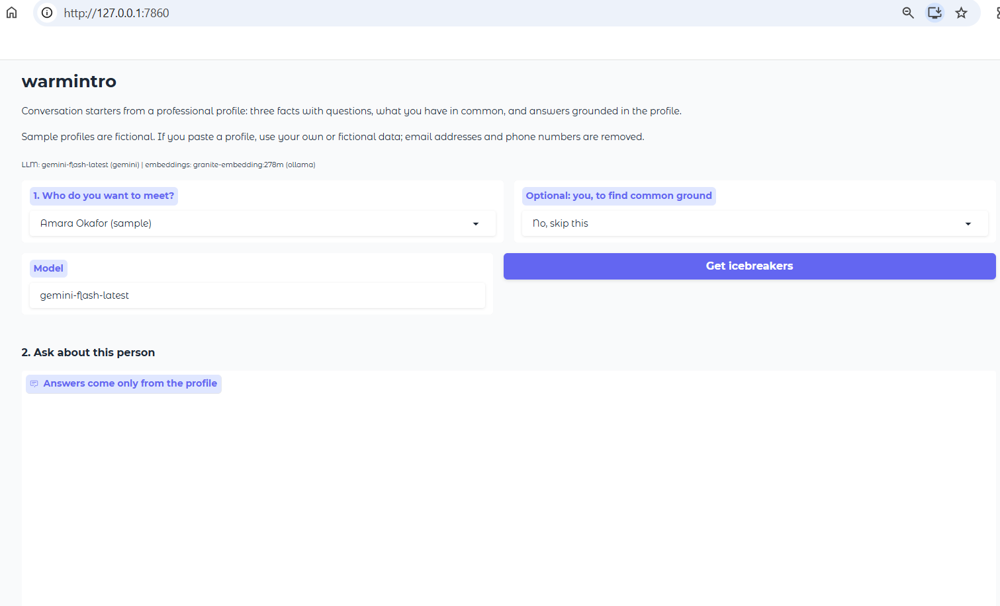
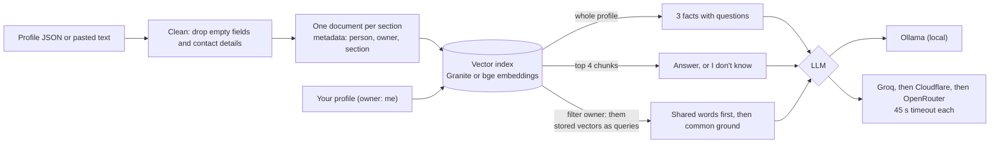
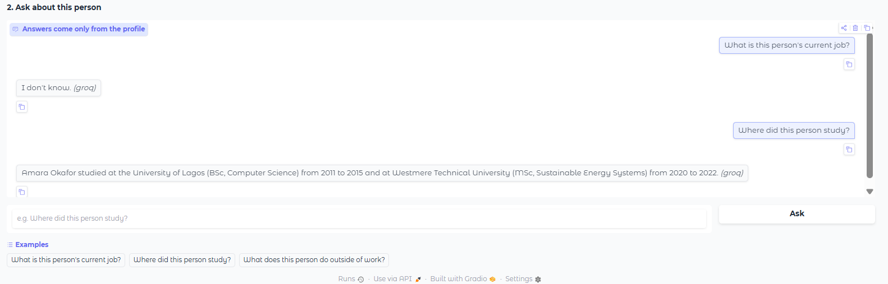

# warmintro: conversation starters from a professional profile


> Based on IBM's **"Build an AI Icebreaker Bot with IBM Granite 3.0 & LlamaIndex"** lab
> (*Build RAG Applications: Get Started* course on Coursera), rebuilt to run **locally
> and free** on IBM Granite via Ollama, extended with a common-ground mode and an answer
> evaluation, and deployed with a fallback across free cloud APIs.
**▶ [Try the live demo](https://warmintro-jaxs.onrender.com)** (free hosting: the first visit after a quiet period takes about a minute while the server wakes up)



Pick a person, and warmintro writes three facts from their profile, each with a question
to open a conversation, finds what you have in common, and answers questions using
only the profile ("I don't know." otherwise). All people in this repo are fictional.

## What this project covers

| Lab part | Where it's implemented |
|---|---|
| 1. Configuration and prompt templates | `src/warmintro/config.py`, `scripts/01_config.py` |
| 2. Concepts: LLMs, RAG stages, mock data vs. API | this README, [How it works](#how-it-works) |
| 3. Profile data extraction | `src/warmintro/profiles.py`, `scripts/02_load_profile.py`, `data/profiles/` |
| 4. Splitting, indexing, checking embeddings | `src/warmintro/index.py`, `scripts/03_build_index.py` |
| 5. LLM and embedding interface | `src/warmintro/llm.py`, `src/warmintro/fallback.py`, `scripts/00_check_setup.py`, `scripts/00_check_cloud.py` |
| 6. Query engine: initial facts and questions | `src/warmintro/query.py`, `scripts/04_initial_facts.py`, `scripts/05_ask.py` |
| 7. Command-line app | `src/warmintro/cli.py` (`uv run warmintro`) |
| 8. Gradio web app | `src/warmintro/webapp.py`, `app.py` |
| **Extension:** common ground between you and them | `src/warmintro/common_ground.py`, `scripts/06_common_ground.py` |
| **Extension:** evaluation, the RAG stage the lab skips | `src/warmintro/evaluate.py`, `scripts/07_evaluate.py`, `data/eval/` |
| **Extension:** deployment and CI | `render.yaml`, `.github/workflows/`, `tests/` (198 tests, no model or network needed) |

## What's different from the original lab

**Changed to run locally and free**
- IBM watsonx.ai → **Ollama** with IBM Granite (`granite4:tiny-h`, `granite-embedding:278m`) on a consumer GPU.
- No LinkedIn scraping: Proxycurl is discontinued, and the lab's mock profile is a real person. The repo uses five **fictional profiles**, plus a paste box for your own. Email addresses and phone numbers are removed, even inside free text.
- Lab notebook-style modules → a package (`src/warmintro`), one script per lab part, `uv`, Python 3.12, LlamaIndex 0.14.
- **Live demo on free cloud APIs:** Groq → Cloudflare Workers AI → OpenRouter, tried in order. Gemini stays available locally, but [Google's terms](https://ai.google.dev/gemini-api/terms) allow only *paid* Gemini for apps offered to users in the EEA, UK or Switzerland, so the public demo doesn't use it.

**Bugs in the lab code that are fixed** (each has a test that fails if the bug comes back)
1. `truncate_input_tokens=3` embedded only the **first 3 tokens** of every chunk. Whole chunks are embedded now.
2. `answer_user_query` retrieved the chunks, built a context string, never used it, then let the query engine retrieve again: two searches per question. Now one.
3. Facts used `decoding_method="sample"` with `temperature=0.0`, which contradicts itself. A sampling preset now requires temperature > 0.
4. `change_llm_model` changed a **global** setting, so in the web app one user's model choice switched it for everyone. The model is now per call and per session.
5. The web app kept every index in a global dict that only grew. Sessions now live in `gr.State` with a one-hour limit and a cap of 50.
6. On failure, `answer_user_query` returned a string, and its callers then crashed reading `.response`. Errors are raised and shown as one friendly line.
7. The whole profile was dumped as **one line of JSON** and split by size, so chunks started mid-object (`"}, {"title": …`). Each section (a job, a school, the skills…) is now its own readable document.
8. `verify_embeddings` read the private `_storage_context` and expected `None` for a missing vector, but `vector_store.get` raises `KeyError`. It now reports missing, all-zero and mixed-size vectors by node ID.
9. The UI showed `f"Error: {e}"` with internal details. Users now get a short message, and tracebacks go to the log only.
10. Also: the splitter's default overlap of 200 tokens on 400-token chunks is now 40; empty fields are cleaned at every level, not only the top; the "~500 characters" comment counted tokens.

## How it works



- **Facts read the whole profile** (13 short chunks). Questions retrieve the top 4. In the first evaluation, retrieving the top 8 for the vague facts request left out every job in 6 of 9 runs.
- **Common ground:** your profile and theirs share one index, tagged `owner=me` and `owner=them`. Each of your chunks searches only their chunks through a LlamaIndex metadata filter, reusing the stored vectors, so there are no extra embedding calls. Pairs that share real words (a school, a language, an instrument) rank first, and those words are given to the model.
- **Fallback:** `FallbackLLM` wraps the free providers. A rate limit, an overload (503/504), a timeout or an empty reply moves on to the next provider, and the app shows which one answered.

## Quick start

**Requirements:** [Ollama](https://ollama.com) and [uv](https://docs.astral.sh/uv/). Tested on Windows 11 with a GTX 1660 Ti (6 GB) and 16 GB RAM.

```bash
ollama pull granite4:tiny-h
ollama pull granite-embedding:278m

git clone https://github.com/hlmhlr/warmintro.git
cd warmintro
uv sync
cp .env.example .env        # Windows PowerShell: copy .env.example .env

uv run python scripts/00_check_setup.py
uv run warmintro --profile amara_okafor --me alex_rivera   # command line
uv run python app.py                                        # web app: http://127.0.0.1:7860
uv run pytest
```

**Cloud mode, like the live demo:** create free keys at Groq, Cloudflare (Workers AI) and OpenRouter, put them in `.env`, then:

```bash
uv sync --extra cloud
# in .env: LLM_PROVIDER=groq,cloudflare,openrouter and EMBEDDINGS_PROVIDER=cloudflare
uv run python scripts/00_check_cloud.py   # checks each provider, never prints keys
uv run python app.py
```

**Lab scripts, in order:** `01_config` → `02_load_profile` → `03_build_index` → `04_initial_facts` → `05_ask` → `06_common_ground` → `07_evaluate` (each runs with `uv run python scripts/<name>.py`).

**Deploy your own:** Render → New → Blueprint → this repo (it reads `render.yaml` and asks for the 4 keys). Then add the service's deploy hook as the GitHub secret `RENDER_DEPLOY_HOOK_URL`. Pushing a `v*` tag runs the tests, then deploys that exact commit.

## Results

All numbers are from real runs on the hardware above.

### Evaluation: before and after fixing the prompts

36 fixed questions over 3 profiles, plus 9 generated facts (3 per profile). Local `granite4:tiny-h`, scored by `scripts/07_evaluate.py`. "Before" is re-judged with the same judge as "after", so the two columns are comparable.

| Check | Before | After |
|---|---|---|
| Answerable questions correct | 17/18 | 17/18 |
| Unanswerable → "I don't know." | 12/12 | 12/12 |
| Qualifier kept ("basic" Italian, a past job) | 5/6 | **6/6** |
| Facts: 3 numbered, each with a question | 3/9 | **9/9** |
| Facts: no numbers missing from the profile | 9/9 | 9/9 |
| Facts: a job was in the context | 3/9 | **9/9** |
| Facts: passed every check | 1/9 | **9/9** |
| Seconds per answer / per facts | 4.1 / 6.7 | 4.2 / 6.8 |

The fixes: facts read the whole profile; the templates require starting at "1.", one fixed layout, no opinions and no new numbers; questions must keep qualifiers; job chunks say "Current job" or "Past job".

**The LLM judge, tested on its own.** It sees 12 statements with known answers, 6 true and 6 with one planted error. The local model accepted all 6 true ones but caught only **1 of 6** errors (**58%**, against 50% for a judge that always says YES). So a 1B-active model is not a reliable judge, and the grounding results above rest on the rule-based checks. An earlier version of the judge rejected 6 of 9 correct facts, by flagging questions and quoting the profile as "unsupported". That is why the judge now gets one fact at a time, with questions removed.

### Cloud vs. local speed

| | Local (GTX 1660 Ti) | Cloud (Groq, first in the chain) |
|---|---|---|
| Model loading | 15.5–16.4 s on the first call | none |
| Answer to a question | 4.1 s | **1.2–1.3 s** |
| Embedding a profile (13 chunks) | 0.6 s | Cloudflare: 1.8 s for one test text |

Live server: **228 MB peak** with 30 sessions held, measured with the exact deployed packages (Render's free plan has 512 MB).

### Retrieval: the bge query instruction

With Cloudflare's `bge-base` embeddings, "What is this person's current job title?" retrieved a *past* job for Amara, and the model correctly said "I don't know.". The bge model card recommends a prefix for short queries (*"Represent this sentence for searching relevant passages: "*), never for stored passages:

| | Amara: current job | Sofia: current job | The other 10 questions |
|---|---|---|---|
| Without the prefix | ❌ "I don't know." | ✅ | all correct |
| With the prefix (default) | ✅ | ✅ | all correct |

### Common ground

The sample profiles contain 10 planted shared topics (same school, running, cello, coding clubs…).

| Version (local Granite) | Planted topics named | Claims not actually shared |
|---|---|---|
| Similarity only | 6/10 | yes: "Swedish" (only Sam speaks it), "Data Science" |
| Shared words first + claim check | 2/10 | **0** (8/8 claims are in both profiles) |

I kept the second version: telling someone "you both studied X" when you didn't is worse than missing a topic. With Groq in the cloud, the Alex–Amara pair named all 3 planted topics (Dutch, marathon, Westmere).



## Limitations

- **Small embedding models cluster profile chunks tightly** (Granite scores of 0.60–0.67), because every chunk names the person. A specific question can still miss its chunk, like Sofia's job title with local Granite (17/18).
- **The local judge can't detect most errors** (58%, above). A larger judge model is the next step; free Gemini isn't an option for an EU-facing app.
- **The common-ground claim check works on words**, so it can't catch a wrong *combination* of words both profiles contain. Seen in a cloud run: "You studied data science at Westmere", when Amara studied Sustainable Energy Systems there.
- **Common-ground recall is low with the local model** (2/10). Weighting shared words by rarity would stop generic words ("Science", "Online") from outranking names like Westmere.
- **The free tiers have limits.** OpenRouter's free router picks a random model; Groq and Cloudflare have daily quotas. The demo allows 20 questions per profile, and if every provider is busy it says so.
- The evaluation is small (36 questions, 9 facts runs, 12 judge statements). It shows differences between versions, not population-level accuracy.

## What I learned

- **RAG with LlamaIndex:** Documents and Nodes, `SentenceSplitter`, `VectorStoreIndex`, query engines with a custom `text_qa_template`, metadata (including hiding fields from the embedding and the LLM), and metadata filters.
- **Chunking is a design decision:** one readable document per profile section beat a JSON dump split by size, and a broad request (the facts) needs different context from a specific question.
- **Evaluate before tuning.** A baseline scorecard showed which fixes mattered. Re-judging old outputs with the new judge kept the before/after fair. Testing the judge itself showed its verdicts couldn't be trusted.
- **Read the provider's details:** a model's thinking tokens count against its output limit, `OpenAILike` silently drops `reasoning_effort` for non-OpenAI models, bge expects a query prefix, and a free tier's terms can rule out a deployment.
- **Production basics:** timeouts and a provider fallback, friendly errors without tracebacks, per-session state, a startup check for the configuration, secrets kept out of git, and tests that fail when a known bug comes back.

## Acknowledgments and references

- Original lab: **"Build an AI Icebreaker Bot with IBM Granite 3.0 & LlamaIndex"** by [Hailey Quach](https://www.haileyq.com/), with Wojciech "Victor" Fulmyk, IBM Skills Network, part of the *Build RAG Applications: Get Started* course on Coursera. © IBM Corporation. This repository is an independent re-implementation; the lab's prompt templates were rewritten, and no LinkedIn data is used.
- [IBM Granite models](https://www.ibm.com/granite/docs/models/granite) · [LlamaIndex](https://docs.llamaindex.ai/) · [Ollama](https://ollama.com) · [Gradio](https://www.gradio.app/)
- Free APIs used by the demo: [Groq](https://console.groq.com/docs/models), [Cloudflare Workers AI](https://developers.cloudflare.com/workers-ai/), [OpenRouter](https://openrouter.ai/docs)
- [BAAI/bge-base-en-v1.5 model card](https://huggingface.co/BAAI/bge-base-en-v1.5) (query instruction)
- Lewis et al. (2020), [*Retrieval-Augmented Generation for Knowledge-Intensive NLP Tasks*](https://arxiv.org/abs/2005.11401)

## License

MIT, see [LICENSE](LICENSE). Applies to the code in this repository only. The sample profiles are fictional and written for this repo.
